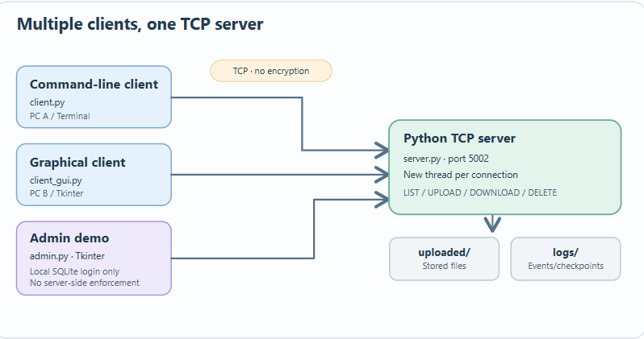
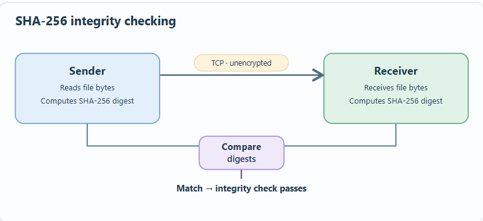

# Advanced File Sharing — Python TCP Client–Server Prototype

**A collaborative academic software project exploring client–server networking, multithreaded connections, file transfer, SHA-256 checksums, and desktop interfaces in Python.**

**Areas:** Computer Networks · Python · Socket Programming · Concurrency · Desktop Applications

## Overview

Advanced File Sharing is a Python-based file-sharing proof of concept built around a central TCP server and multiple client interfaces. It supports file listing, upload, and download operations, with checksum comparisons to help detect transfer errors. The project also includes a Tkinter desktop interface and a separate local login/administration demonstration.


## System Architecture




The server creates a new thread for each accepted connection. Its default address is `localhost:5002`, so it runs on a single computer out of the box. The same client–server design can be **configured for multiple computers on a trusted local network** and has been tested. 

The SQLite login in `admin.py` controls the **local interface only**. 

## Features

| Component | Implementation |
| --- | --- |
| **Client–server communication** | TCP sockets with text commands and chunked file data. |
| **Concurrent client handling** | A separate server-side thread for each accepted connection. |
| **File management** | File listing, upload, download, and a server-side delete command exposed by the admin demo. |
| **Integrity checking** | SHA-256 digest comparisons for uploads and downloads. |
| **Command-line client** | Interactive commands; download progress, speed, elapsed time, and estimated time remaining. |
| **Desktop interface** | Tkinter file browser with upload/download controls and progress feedback. |
| **Local account demo** | SQLite-backed login and role-dependent Tkinter controls. |
| **Logging** | Timestamped activity logs and JSON checkpoint data. |
| **Experimental functions** | Partial-download checkpoints/resume and archived file versions. |

## SHA-256 File Integrity



Both ends compute SHA-256 digests for transferred file contents. Comparing the digests can reveal accidental corruption or mismatched bytes.

The local login demo also uses SHA-256 to store password digests. 

## Technology Stack

| Area | Technologies |
| --- | --- |
| Language | Python 3.8+ |
| Network communication | `socket` (TCP) |
| Concurrency | `threading` |
| Graphical user interface | Tkinter |
| File integrity | `hashlib` / SHA-256 |
| Local user data | SQLite (`sqlite3`) |
| Logs and checkpoints | Text files and JSON |

The core project uses the Python standard library. There are no third-party Python package dependencies; Tkinter must be available separately if it is not included in your Python installation.

## Project Structure

```text
Advanced_File_Sharing/
├── server.py               # TCP server and per-connection handlers
├── client.py               # Interactive command-line client
├── client_gui.py           # Tkinter file-transfer client
├── admin.py                # Local SQLite login and admin UI demo
├── setupdb.py              # Creates sample local user records
├── docs/
│   └── images/
│       ├── multi-client-architecture.svg
│       └── sha256-integrity-check.svg
├── .gitignore
└── README.md

# Generated during local use (excluded from Git):
# uploaded/                Server-side files and VersionHistory/
# downloaded/              Client download directory
# logs/                    Activity logs and checkpoint files
# users.db                 Local SQLite login demonstration database
```

## Getting Started

**Requirements:** Python 3.8+; Tkinter only for the graphical interfaces. Run commands from the repository root because the application uses relative paths.

### 1. Clone

```bash
git clone https://github.com/talahareb/Advanced_File_Sharing.git
cd Advanced_File_Sharing
```

### 2. Prepare local directories

The server creates `logs/` and `uploaded/`, but the command-line client needs `downloaded/` to exist before it saves a file. Create the folders first:

```bash
python -c "from pathlib import Path; [Path(p).mkdir(exist_ok=True) for p in ('logs', 'uploaded', 'downloaded')]"
```

### 3. Start the server

```bash
python server.py
```

The server binds to `localhost:5002` by default. Leave this terminal running.

### 4. Run a client

**Command line** — open another terminal in the project root:

```bash
python client.py
```

Example commands:

```text
LIST
UPLOAD example.txt
DOWNLOAD example.txt
EXIT
```

Create a non-sensitive test file named `example.txt` before uploading it. The download command writes to `downloaded/`.

**Graphical interface** — alternatively, launch:

```bash
python client_gui.py
```

Click **Connect to server**, then choose files to upload or download.

### 5. Optional: local login and admin demonstration

```bash
python setupdb.py
python admin.py
```

`setupdb.py` creates demonstration accounts (inspect the script for credentials). The admin UI offers delete and log-viewing controls; the log viewer invokes Windows Notepad. **These controls are not enforced by server-side authentication.**

### Optional: connections from other computers on a LAN

For a **trusted test network only**, the code can be configured as follows:

1. Change `HOST` in `server.py` from `localhost` to `0.0.0.0` so the server listens on network interfaces.
2. Set `HOST` in the client script you use (`client.py`, `client_gui.py`, or `admin.py`) to the server computer's **LAN IP address**.
3. Keep the TCP port consistent (`5002` by default) and allow that port through the server computer's firewall as needed.
4. Start the server, then connect clients from the other machines.


## How a Transfer Works

1. The client opens a TCP connection and sends a command such as `LIST`, `UPLOAD`, or `DOWNLOAD`.
2. The sender sends file bytes in chunks, with file length communicated as part of the protocol.
3. The receiving side saves the bytes and computes a SHA-256 digest.
4. The two ends compare digests and report whether they match.
5. Client and server record relevant events in local logs.

The implementation includes experimental checkpoint-based download resume and file archiving. 

## Limitations

- **Unencrypted:** transferred files and commands are not confidential on the network.
- **No server-side authentication or authorization:** the login screen protects only an interface, not the TCP service.


## Project Context

Developed as a **collaborative academic project** focused on practical networking and software engineering concepts. The project demonstrates TCP sockets, concurrent client handling, local file operations, checksum comparison, desktop UI development, and the engineering trade-offs of an educational file-transfer protocol.
